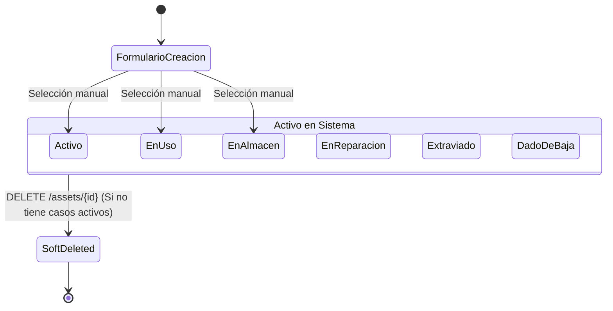
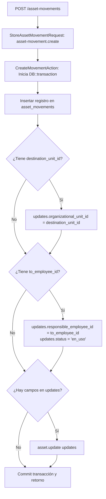
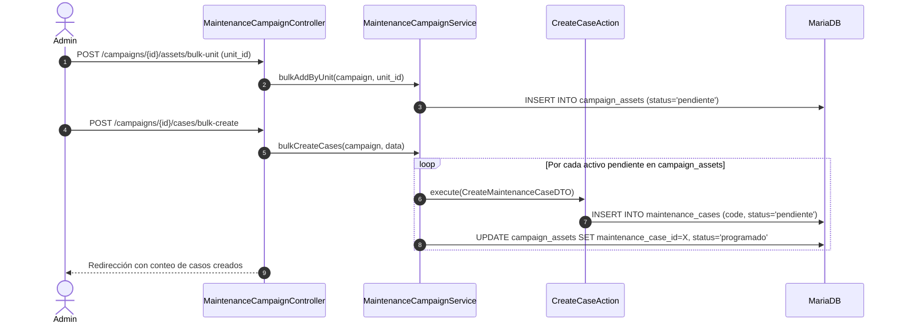
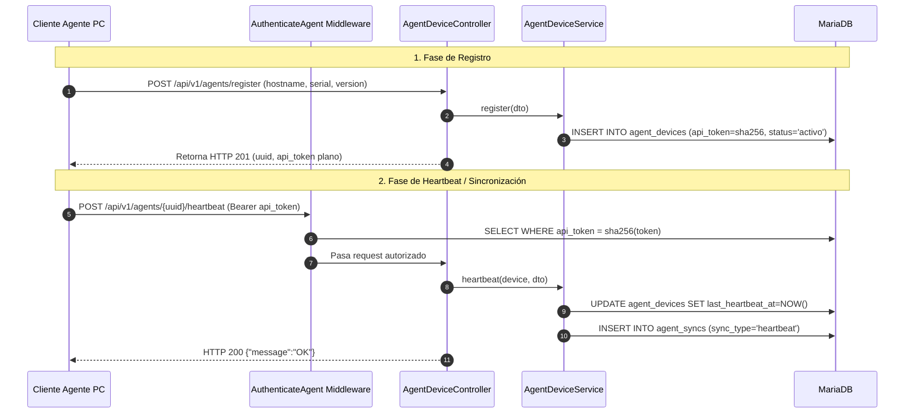
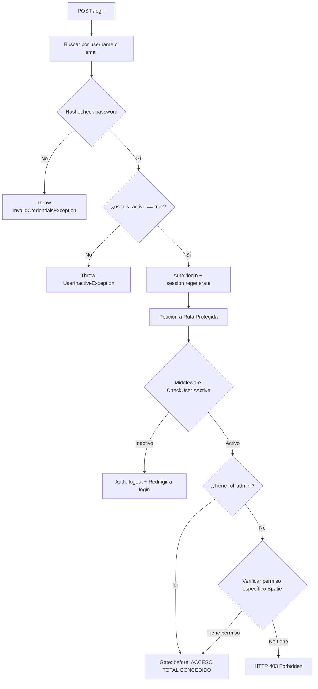
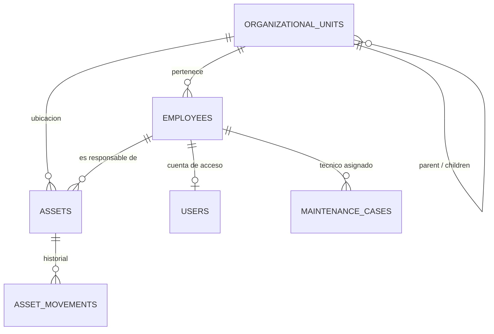

# Documentación de Flujos Actuales del Sistema (Auditoría Técnica)

> **Propósito del documento**: Registrar con precisión técnica y citas exactas de código cómo opera **HOY** el sistema de mantenimiento y activos OTI.  
> **Reglas de redacción**:
> - Solo describe lo que el código hace efectivamente (cero suposiciones).
> - Cada afirmación contiene referencia a archivo y número de línea.
> - Se separa estrictamente **HECHOS** (comportamiento real comprobable) de **OBSERVACIONES** (deuda técnica, inconsistencias o código muerto).

---

## Tabla de Contenidos
1. [Flujo 1: Alta, edición y baja de un Activo](#flujo-1-alta-edición-y-baja-de-un-activo)
2. [Flujo 2: Movimientos de Activo](#flujo-2-movimientos-de-activo)
3. [Flujo 3: Ciclo de vida de un Caso de Mantenimiento](#flujo-3-ciclo-de-vida-de-un-caso-de-mantenimiento)
4. [Flujo 4: Campañas de Mantenimiento y Generación de Casos](#flujo-4-campañas-de-mantenimiento-y-generación-de-casos)
5. [Flujo 5: Plantillas e Ítems de Mantenimiento](#flujo-5-plantillas-e-ítems-de-mantenimiento)
6. [Flujo 6: Agente API (Monitoreo e Inventario)](#flujo-6-agente-api-monitoreo-e-inventario)
7. [Flujo 7: Login, Roles y Permisos](#flujo-7-login-roles-y-permisos)
8. [Flujo 8: Estructura Organizacional y Empleados](#flujo-8-estructura-organizacional-y-empleados)
9. [Mapa de Relaciones de las 30 Tablas](#mapa-de-relaciones-de-las-30-tablas)
10. [Lista de Reglas de Negocio Implícitas](#lista-de-reglas-de-negocio-implícitas)
11. [Preguntas Abiertas para el Dueño del Sistema](#preguntas-abiertas-para-el-dueño-del-sistema)

---

## Flujo 1: Alta, edición y baja de un Activo

### a) Recorrido completo

#### 1. Alta (Creación)
- **Ruta**: `POST /assets` (`assets.store`) definida en [routes/web.php:64](file:///c:/Users/Jeanpier/Documents/OTI/mantenimiento-oti/routes/web.php#L64).
- **Middleware**: `['auth', 'user.active', 'permission:asset.view']` aplicados al grupo en [routes/web.php:31,62](file:///c:/Users/Jeanpier/Documents/OTI/mantenimiento-oti/routes/web.php#L31).
- **FormRequest**: [app/Http/Requests/Asset/StoreAssetRequest.php:11-40](file:///c:/Users/Jeanpier/Documents/OTI/mantenimiento-oti/app/Http/Requests/Asset/StoreAssetRequest.php#L11-L40).
  - Autorización: `$this->user()->can('asset.create')` en línea 15.
  - Validación: Valida `name`, `asset_type`, `status`, `condition`, unicidad de `internal_code`, `patrimonial_code`, `serial_number`, y pertenencia de `organizational_unit_id` y `responsible_employee_id`.
- **Controlador**: [app/Http/Controllers/AssetController.php:54-62](file:///c:/Users/Jeanpier/Documents/OTI/mantenimiento-oti/app/Http/Controllers/AssetController.php#L54-L62) en método `store()`.
  - Construye `CreateAssetDTO::fromArray($request->validated())`.
  - Llama a `AssetService::create()`.
- **Service**: [app/Services/Asset/AssetService.php:32-35](file:///c:/Users/Jeanpier/Documents/OTI/mantenimiento-oti/app/Services/Asset/AssetService.php#L32-L35). Invoca `$this->createAction->execute($dto)`.
- **Action**: [app/Actions/Asset/CreateAssetAction.php:11-16](file:///c:/Users/Jeanpier/Documents/OTI/mantenimiento-oti/app/Actions/Asset/CreateAssetAction.php#L11-L16). Ejecuta `DB::transaction()` y llama a `Asset::create($dto->toArray())`.
- **Modelo**: [app/Models/Asset.php:50-57](file:///c:/Users/Jeanpier/Documents/OTI/mantenimiento-oti/app/Models/Asset.php#L50-L57). El hook de Eloquent `booted()` genera un UUID v4 automático si el campo `uuid` está vacío al crear el registro.
- **Tablas afectadas**: `assets` (INSERT).

#### 2. Edición (Actualización)
- **Ruta**: `PUT/PATCH /assets/{asset}` (`assets.update`) en [routes/web.php:64](file:///c:/Users/Jeanpier/Documents/OTI/mantenimiento-oti/routes/web.php#L64).
- **Middleware**: `['auth', 'user.active', 'permission:asset.view']` en [routes/web.php:31,62](file:///c:/Users/Jeanpier/Documents/OTI/mantenimiento-oti/routes/web.php#L31).
- **FormRequest**: [app/Http/Requests/Asset/UpdateAssetRequest.php:12-42](file:///c:/Users/Jeanpier/Documents/OTI/mantenimiento-oti/app/Http/Requests/Asset/UpdateAssetRequest.php#L12-L42).
  - Autorización: `$this->user()->can('asset.edit')` en línea 16.
  - Validación: Ignora el propio activo y registros con soft delete (`whereNull('deleted_at')`) en líneas 28, 29 y 32.
- **Controlador**: [app/Http/Controllers/AssetController.php:86-95](file:///c:/Users/Jeanpier/Documents/OTI/mantenimiento-oti/app/Http/Controllers/AssetController.php#L86-L95) en método `update()`.
- **Service**: [app/Services/Asset/AssetService.php:37-40](file:///c:/Users/Jeanpier/Documents/OTI/mantenimiento-oti/app/Services/Asset/AssetService.php#L37-L40).
- **Action**: [app/Actions/Asset/UpdateAssetAction.php:11-18](file:///c:/Users/Jeanpier/Documents/OTI/mantenimiento-oti/app/Actions/Asset/UpdateAssetAction.php#L11-L18). En `DB::transaction()` ejecuta `$asset->update($dto->toArray())` y retorna `$asset->fresh()`.
- **Tablas afectadas**: `assets` (UPDATE).

#### 3. Baja / Eliminación (Soft Delete)
- **Ruta**: `DELETE /assets/{asset}` (`assets.destroy`) en [routes/web.php:64](file:///c:/Users/Jeanpier/Documents/OTI/mantenimiento-oti/routes/web.php#L64).
- **Middleware**: `['auth', 'user.active', 'permission:asset.view']` en [routes/web.php:31,62](file:///c:/Users/Jeanpier/Documents/OTI/mantenimiento-oti/routes/web.php#L31).
- **FormRequest**: NO USA FormRequest dedicado.
- **Controlador**: [app/Http/Controllers/AssetController.php:139-147](file:///c:/Users/Jeanpier/Documents/OTI/mantenimiento-oti/app/Http/Controllers/AssetController.php#L139-L147). Verifica autorización inline con `$this->authorize('asset.delete')` en línea 141.
- **Service**: [app/Services/Asset/AssetService.php:42-51](file:///c:/Users/Jeanpier/Documents/OTI/mantenimiento-oti/app/Services/Asset/AssetService.php#L42-L51).
  - Condición previa: Verifica si existen casos de mantenimiento no cerrados:
    ```php
    if ($asset->maintenanceCases()->whereNotIn('status', ['completado', 'cancelado'])->exists()) {
        throw AssetException::hasActiveMaintenanceCases($asset->name);
    }
    ```
    ([AssetService.php:44-48](file:///c:/Users/Jeanpier/Documents/OTI/mantenimiento-oti/app/Services/Asset/AssetService.php#L44-L48)).
  - Ejecución: `$asset->delete()`.
- **Action**: NO EXISTE Action para eliminar activos; la llamada a `$asset->delete()` se realiza directamente en el Service ([AssetService.php:50](file:///c:/Users/Jeanpier/Documents/OTI/mantenimiento-oti/app/Services/Asset/AssetService.php#L50)).
- **Modelo**: [app/Models/Asset.php:18](file:///c:/Users/Jeanpier/Documents/OTI/mantenimiento-oti/app/Models/Asset.php#L18) implementa `Illuminate\Database\Eloquent\SoftDeletes`.
- **Tablas afectadas**: `assets` (UPDATE del campo `deleted_at`).

---

### b) Qué estados cambian y qué condiciones lo permiten
- **En alta**: El estado inicial no es asignado por el sistema de forma fija; es elegido por el usuario en el formulario entre los casos de [app/Enums/AssetStatus.php:7-12](file:///c:/Users/Jeanpier/Documents/OTI/mantenimiento-oti/app/Enums/AssetStatus.php#L7-L12) (`activo`, `en_uso`, `en_almacen`, `en_reparacion`, `dado_de_baja`, `extraviado`).
- **En edición**: El usuario puede pasar el activo a cualquier valor de `AssetStatus` sin restricciones de máquina de estados en el backend ([UpdateAssetRequest.php:26](file:///c:/Users/Jeanpier/Documents/OTI/mantenimiento-oti/app/Http/Requests/Asset/UpdateAssetRequest.php#L26)).
- **En eliminación (`destroy`)**: El valor de la columna `status` **NO cambia**. Se preserva el último estado que tenía el registro y solo se llena `deleted_at`.

---

### c) Efectos secundarios
- **Eventos de dominio**: NO ENCONTRADO. No se emite ningún evento (`Event::dispatch`) ni observer registrado.
- **Notificaciones**: NO ENCONTRADO.
- **Vínculos con agentes**: Si el activo posee un agente en `agent_devices.asset_id`, el registro en `agent_devices` queda intacto apuntando a un ID que ahora tiene `deleted_at` no nulo.

---

### d) Uso de transacciones de base de datos
- **Alta (`store`)**: SÍ usa `DB::transaction()` en [CreateAssetAction.php:13](file:///c:/Users/Jeanpier/Documents/OTI/mantenimiento-oti/app/Actions/Asset/CreateAssetAction.php#L13). Si falla, hace rollback completo.
- **Edición (`update`)**: SÍ usa `DB::transaction()` en [UpdateAssetAction.php:13](file:///c:/Users/Jeanpier/Documents/OTI/mantenimiento-oti/app/Actions/Asset/UpdateAssetAction.php#L13).
- **Eliminación (`destroy`)**: NO usa `DB::transaction()` en [AssetService.php:42-51](file:///c:/Users/Jeanpier/Documents/OTI/mantenimiento-oti/app/Services/Asset/AssetService.php#L42-L51).

---

### e) Quién puede ejecutarlo (Rol / Permiso)
- Ver activos (`index`, `show`): Permiso `asset.view` en [routes/web.php:62](file:///c:/Users/Jeanpier/Documents/OTI/mantenimiento-oti/routes/web.php#L62) y [AssetController.php:28,66](file:///c:/Users/Jeanpier/Documents/OTI/mantenimiento-oti/app/Http/Controllers/AssetController.php#L28). (Roles: `admin`, `responsable_oficina`, `tecnico`, `empleado`).
- Crear (`create`, `store`): Permiso `asset.create` en [AssetController.php:43](file:///c:/Users/Jeanpier/Documents/OTI/mantenimiento-oti/app/Http/Controllers/AssetController.php#L43) y [StoreAssetRequest.php:15](file:///c:/Users/Jeanpier/Documents/OTI/mantenimiento-oti/app/Http/Requests/Asset/StoreAssetRequest.php#L15). (Roles: `admin`, `responsable_oficina`).
- Editar (`edit`, `update`): Permiso `asset.edit` en [AssetController.php:75](file:///c:/Users/Jeanpier/Documents/OTI/mantenimiento-oti/app/Http/Controllers/AssetController.php#L75) y [UpdateAssetRequest.php:16](file:///c:/Users/Jeanpier/Documents/OTI/mantenimiento-oti/app/Http/Requests/Asset/UpdateAssetRequest.php#L16). (Roles: `admin`, `responsable_oficina`).
- Eliminar (`destroy`): Permiso `asset.delete` en [AssetController.php:141](file:///c:/Users/Jeanpier/Documents/OTI/mantenimiento-oti/app/Http/Controllers/AssetController.php#L141). (Asignado únicamente al rol `admin` mediante sincronización total en [RolePermissionSeeder.php:44](file:///c:/Users/Jeanpier/Documents/OTI/mantenimiento-oti/database/seeders/RolePermissionSeeder.php#L44)).

---

### f) Diagrama de Estados (Mermaid)



---

### g) Observaciones
1. **Inconsistencia en validación de unicidad de códigos**:
   - En [StoreAssetRequest.php:25-29](file:///c:/Users/Jeanpier/Documents/OTI/mantenimiento-oti/app/Http/Requests/Asset/StoreAssetRequest.php#L25-L29), las reglas `unique:assets,internal_code`, `unique:assets,patrimonial_code` y `unique:assets,serial_number` **NO** excluyen registros eliminados por soft delete.
   - En cambio, en [UpdateAssetRequest.php:28-32](file:///c:/Users/Jeanpier/Documents/OTI/mantenimiento-oti/app/Http/Requests/Asset/UpdateAssetRequest.php#L28-L32), sí se utiliza `whereNull('deleted_at')`.  
   *Efecto*: Si se borra un activo antiguo con código `X`, el sistema impedirá registrar uno nuevo con el código `X`.
2. **Uso de strings hardcodeados en lugar del Enum**:
   - En [AssetService.php:45](file:///c:/Users/Jeanpier/Documents/OTI/mantenimiento-oti/app/Services/Asset/AssetService.php#L45) se valida `whereNotIn('status', ['completado', 'cancelado'])` utilizando strings literales en vez de `MaintenanceCaseStatus::COMPLETADO->value` y `MaintenanceCaseStatus::CANCELADO->value`.
3. **Discrepancia semántica entre "Baja" y "Eliminar"**:
   - Existe el estado de enum `AssetStatus::DADO_DE_BAJA` y el movimiento `MovementType::BAJA`, pero el endpoint de eliminación física/lógica `destroy` no marca el estado como `dado_de_baja`, simplemente oculta la fila con `deleted_at`.

---

## Flujo 2: Movimientos de Activo

### a) Recorrido completo
- **Ruta**: `POST /asset-movements` (`asset-movements.store`) en [routes/web.php:71](file:///c:/Users/Jeanpier/Documents/OTI/mantenimiento-oti/routes/web.php#L71).
- **Middleware**: `['auth', 'user.active', 'permission:asset-movement.view']` en [routes/web.php:31,70](file:///c:/Users/Jeanpier/Documents/OTI/mantenimiento-oti/routes/web.php#L31).
- **FormRequest**: [app/Http/Requests/AssetMovement/StoreAssetMovementRequest.php:9-32](file:///c:/Users/Jeanpier/Documents/OTI/mantenimiento-oti/app/Http/Requests/AssetMovement/StoreAssetMovementRequest.php#L9-L32).
  - Autorización: `$this->user()->can('asset-movement.create')` en línea 13.
  - Reglas: `asset_id` (requerido), `movement_type` (Enum `MovementType`), `origin_unit_id` (opcional), `destination_unit_id` (opcional), `from_employee_id` (opcional), `to_employee_id` (opcional), `movement_date` (fecha requerida), `reason` (requerido).
- **Controlador**: [app/Http/Controllers/AssetMovementController.php:42-55](file:///c:/Users/Jeanpier/Documents/OTI/mantenimiento-oti/app/Http/Controllers/AssetMovementController.php#L42-L55) en método `store()`. Inyecta `'created_by' => auth()->id()`.
- **Service**: [app/Services/AssetMovement/AssetMovementService.php:34-37](file:///c:/Users/Jeanpier/Documents/OTI/mantenimiento-oti/app/Services/AssetMovement/AssetMovementService.php#L34-L37).
- **Action**: [app/Actions/AssetMovement/CreateMovementAction.php:11-37](file:///c:/Users/Jeanpier/Documents/OTI/mantenimiento-oti/app/Actions/AssetMovement/CreateMovementAction.php#L11-L37).
  - Ejecuta dentro de `DB::transaction()`:
    1. `AssetMovement::create($dto->toArray())` en línea 16.
    2. Carga `$asset = Asset::findOrFail($dto->asset_id)` en línea 19.
    3. Si `$dto->destination_unit_id` no es nulo, asigna `$updates['organizational_unit_id'] = $dto->destination_unit_id` (líneas 22-24).
    4. Si `$dto->to_employee_id` no es nulo, asigna `$updates['responsible_employee_id'] = $dto->to_employee_id` y `$updates['status'] = AssetStatus::EN_USO->value` (líneas 26-29).
    5. Si `$updates` tiene campos, ejecuta `$asset->update($updates)` (líneas 31-33).
- **Tablas afectadas**:
  - `asset_movements` (INSERT).
  - `assets` (UPDATE opcional de `organizational_unit_id`, `responsible_employee_id`, `status`).

---

### b) Qué estados cambian y qué condiciones lo permiten
- **Estado del activo (`assets.status`)**:
  - Cambia a `en_uso` **exclusivamente si** se envía un valor en `to_employee_id` ([CreateMovementAction.php:28](file:///c:/Users/Jeanpier/Documents/OTI/mantenimiento-oti/app/Actions/AssetMovement/CreateMovementAction.php#L28)).
  - Si `to_employee_id` es nulo, el estado del activo **NO se modifica**.
- **Tipo de movimiento (`movement_type`)**:
  - Los tipos definidos en el enum son: `asignacion`, `traslado`, `devolucion`, `baja`, `ingreso`, `prestamo` ([app/Enums/MovementType.php:7-12](file:///c:/Users/Jeanpier/Documents/OTI/mantenimiento-oti/app/Enums/MovementType.php#L7-L12)).
  - "Enviar a taller": **NO ENCONTRADO** en `MovementType`.
  - El valor del campo `movement_type` es ignorado por la lógica de actualización del activo en [CreateMovementAction.php:18-34](file:///c:/Users/Jeanpier/Documents/OTI/mantenimiento-oti/app/Actions/AssetMovement/CreateMovementAction.php#L18-L34).

---

### c) Efectos secundarios
- Actualiza las columnas `organizational_unit_id` y `responsible_employee_id` del activo en la tabla `assets`.
- No genera documentos ni PDF automáticamente (la generación de actas se realiza en controladores separados).
- No emite eventos, observers ni notificaciones.

---

### d) Uso de transacciones de base de datos
- SÍ usa `DB::transaction()` en [CreateMovementAction.php:15-36](file:///c:/Users/Jeanpier/Documents/OTI/mantenimiento-oti/app/Actions/AssetMovement/CreateMovementAction.php#L15-L36). Si la actualización del activo falla, la inserción del movimiento es revertida.

---

### e) Quién puede ejecutarlo (Rol / Permiso)
- Ver movimientos: Permiso `asset-movement.view` en [routes/web.php:70](file:///c:/Users/Jeanpier/Documents/OTI/mantenimiento-oti/routes/web.php#L70) y [AssetMovementController.php:21](file:///c:/Users/Jeanpier/Documents/OTI/mantenimiento-oti/app/Http/Controllers/AssetMovementController.php#L21). (Roles: `admin`, `responsable_oficina`).
- Crear movimientos: Permiso `asset-movement.create` en [AssetMovementController.php:32](file:///c:/Users/Jeanpier/Documents/OTI/mantenimiento-oti/app/Http/Controllers/AssetMovementController.php#L32) y [StoreAssetMovementRequest.php:13](file:///c:/Users/Jeanpier/Documents/OTI/mantenimiento-oti/app/Http/Requests/AssetMovement/StoreAssetMovementRequest.php#L13). (Roles: `admin`, `responsable_oficina`).
- Los roles `tecnico` y `empleado` **NO** tienen este permiso según [RolePermissionSeeder.php:46-64](file:///c:/Users/Jeanpier/Documents/OTI/mantenimiento-oti/database/seeders/RolePermissionSeeder.php#L46-L64).

---

### f) Diagrama de Lógica de Movimiento (Mermaid)



---

### g) Observaciones
1. **El tipo de movimiento no gobierna el efecto en el activo**:
   - Si se registra una `devolucion`, el código **no** limpia el campo `responsible_employee_id` ni cambia el estado a `en_almacen`, a menos que se implemente externamente; en el código actual de [CreateMovementAction.php](file:///c:/Users/Jeanpier/Documents/OTI/mantenimiento-oti/app/Actions/AssetMovement/CreateMovementAction.php) solo evalúa si `to_employee_id` existe.
   - Si se registra una `baja`, el estado del activo en `assets.status` **no** pasa a `dado_de_baja`.
2. **Falta de validación del estado previo del activo**:
   - No se valida que `origin_unit_id` coincida con la unidad actual del activo, ni que `from_employee_id` sea el empleado que realmente tenía el activo asignado. Se permite ingresar cualquier par de valores en el formulario.

---

## Flujo 3: Ciclo de vida de un Caso de mantenimiento

### a) Recorrido completo

#### 1. Creación de un caso
Existen dos vías de creación en código:
- **Vía Administrativa**:
  - Ruta: `POST /maintenance-cases` (`maintenance-cases.store`) en [routes/web.php:86](file:///c:/Users/Jeanpier/Documents/OTI/mantenimiento-oti/routes/web.php#L86).
  - FormRequest: [app/Http/Requests/MaintenanceCase/StoreMaintenanceCaseRequest.php](file:///c:/Users/Jeanpier/Documents/OTI/mantenimiento-oti/app/Http/Requests/MaintenanceCase/StoreMaintenanceCaseRequest.php) (verifica `maintenance-case.create`).
  - Controlador: [app/Http/Controllers/MaintenanceCaseController.php:62-76](file:///c:/Users/Jeanpier/Documents/OTI/mantenimiento-oti/app/Http/Controllers/MaintenanceCaseController.php#L62-L76).
  - Service: [app/Services/MaintenanceCase/MaintenanceCaseService.php:37-40](file:///c:/Users/Jeanpier/Documents/OTI/mantenimiento-oti/app/Services/MaintenanceCase/MaintenanceCaseService.php#L37-L40).
  - Action: [app/Actions/MaintenanceCase/CreateCaseAction.php:11-18](file:///c:/Users/Jeanpier/Documents/OTI/mantenimiento-oti/app/Actions/MaintenanceCase/CreateCaseAction.php#L11-L18). Genera correlativo en `generateCode()` (`CASO-YYYYMM-XXXX`) en líneas 20-28.
- **Vía Técnica Directa (Atender Activo)**:
  - Ruta: `POST /tecnico/atender` (`tecnico.attend-asset.store`) en [routes/web.php:127](file:///c:/Users/Jeanpier/Documents/OTI/mantenimiento-oti/routes/web.php#L127).
  - Controlador: [app/Http/Controllers/TechnicianController.php:168-193](file:///c:/Users/Jeanpier/Documents/OTI/mantenimiento-oti/app/Http/Controllers/TechnicianController.php#L168-L193).
  - Service: [app/Services/Technician/TechnicianService.php:136-179](file:///c:/Users/Jeanpier/Documents/OTI/mantenimiento-oti/app/Services/Technician/TechnicianService.php#L136-L179) en método `registerAttention()`. Crea el caso, crea ítems iniciales en bucle y si `final_status === 'completado'`, invoca inmediatamente `CloseCaseAction`.

#### 2. Asignación de técnico
- Se realiza mediante el campo `assigned_technician_id` (FK a `employees.id`).
- Puede asignarse al crear el caso o al editarlo mediante [app/Actions/MaintenanceCase/UpdateCaseAction.php:19-22](file:///c:/Users/Jeanpier/Documents/OTI/mantenimiento-oti/app/Actions/MaintenanceCase/UpdateCaseAction.php#L19-L22).

#### 3. Ejecución de Checklist e Ítems
- **Agregar ítem manual**:
  - `POST /maintenance-cases/{case}/items` en [MaintenanceCaseController.php:143-155](file:///c:/Users/Jeanpier/Documents/OTI/mantenimiento-oti/app/Http/Controllers/MaintenanceCaseController.php#L143-L155) o `POST /tecnico/casos/{case}/items` en [TechnicianController.php:195-209](file:///c:/Users/Jeanpier/Documents/OTI/mantenimiento-oti/app/Http/Controllers/TechnicianController.php#L195-L209).
  - FormRequest: [app/Http/Requests/MaintenanceItem/StoreMaintenanceItemRequest.php](file:///c:/Users/Jeanpier/Documents/OTI/mantenimiento-oti/app/Http/Requests/MaintenanceItem/StoreMaintenanceItemRequest.php).
  - Service: [MaintenanceCaseService.php:52-55](file:///c:/Users/Jeanpier/Documents/OTI/mantenimiento-oti/app/Services/MaintenanceCase/MaintenanceCaseService.php#L52-L55).
  - Tabla: `maintenance_items` (INSERT con `item_type`, `quantity`, `unit_cost`, `total_cost`).
- **Aplicar plantilla**:
  - `POST /maintenance-cases/{case}/apply-template` en [MaintenanceCaseController.php:89-109](file:///c:/Users/Jeanpier/Documents/OTI/mantenimiento-oti/app/Http/Controllers/MaintenanceCaseController.php#L89-L109) o en [TechnicianController.php:223-247](file:///c:/Users/Jeanpier/Documents/OTI/mantenimiento-oti/app/Http/Controllers/TechnicianController.php#L223-L247).
  - Copia los ítems de `maintenance_template_items` hacia `maintenance_items`.
- **Actualizar progreso y diagnóstico técnico**:
  - `PATCH /tecnico/casos/{case}/progreso` en [TechnicianController.php:100-166](file:///c:/Users/Jeanpier/Documents/OTI/mantenimiento-oti/app/Http/Controllers/TechnicianController.php#L100-L166).
  - Actualiza `diagnosis`, `problem_description`, `actions_taken` y cambia el estado técnico según reglas de línea 128-132.

#### 4. Cierre del caso
- **Ruta**: `PATCH /maintenance-cases/{case}/close` en [MaintenanceCaseController.php:135-141](file:///c:/Users/Jeanpier/Documents/OTI/mantenimiento-oti/app/Http/Controllers/MaintenanceCaseController.php#L135-L141) o `PATCH /tecnico/casos/{case}/close` en [TechnicianController.php:249-256](file:///c:/Users/Jeanpier/Documents/OTI/mantenimiento-oti/app/Http/Controllers/TechnicianController.php#L249-L256).
- **FormRequest**: [app/Http/Requests/MaintenanceCase/CloseMaintenanceCaseRequest.php](file:///c:/Users/Jeanpier/Documents/OTI/mantenimiento-oti/app/Http/Requests/MaintenanceCase/CloseMaintenanceCaseRequest.php). Requiere `actions_taken`.
- **Action**: [app/Actions/MaintenanceCase/CloseCaseAction.php:12-32](file:///c:/Users/Jeanpier/Documents/OTI/mantenimiento-oti/app/Actions/MaintenanceCase/CloseCaseAction.php#L12-L32).
  - Valida que no esté previamente cerrado:
    ```php
    if ($case->status === MaintenanceCaseStatus::COMPLETADO || $case->status === MaintenanceCaseStatus::CANCELADO) {
        throw MaintenanceCaseException::alreadyClosed($case->code);
    }
    ```
    ([CloseCaseAction.php:14-16](file:///c:/Users/Jeanpier/Documents/OTI/mantenimiento-oti/app/Actions/MaintenanceCase/CloseCaseAction.php#L14-L16)).
  - En `DB::transaction()`, actualiza: `status = 'completado'`, `finished_at = now()`, `total_cost = data['total_cost'] ?? $case->items()->sum('total_cost')`, datos de conformidad.
- **Reabrir**: **NO ENCONTRADO** / **NO EXISTE**. No hay ruta, método ni acción en el sistema para cambiar un caso de `completado` o `cancelado` a un estado abierto. Cualquier intento de actualizar un caso cerrado lanza la excepción `alreadyClosed` ([CloseCaseAction.php:15](file:///c:/Users/Jeanpier/Documents/OTI/mantenimiento-oti/app/Actions/MaintenanceCase/CloseCaseAction.php#L15), [UpdateCaseAction.php:16](file:///c:/Users/Jeanpier/Documents/OTI/mantenimiento-oti/app/Actions/MaintenanceCase/UpdateCaseAction.php#L16), [TechnicianService.php:115](file:///c:/Users/Jeanpier/Documents/OTI/mantenimiento-oti/app/Services/Technician/TechnicianService.php#L115)).

---

### b) Qué estados cambian y qué condiciones lo permiten
Los estados posibles están definidos en [app/Enums/MaintenanceCaseStatus.php:7-11](file:///c:/Users/Jeanpier/Documents/OTI/mantenimiento-oti/app/Enums/MaintenanceCaseStatus.php#L7-L11):
1. `pendiente`: Estado inicial al crearse.
2. `en_progreso`: Asignado cuando el técnico actualiza progreso si el estado actual es `pendiente` o `en_progreso` ([TechnicianController.php:130-132](file:///c:/Users/Jeanpier/Documents/OTI/mantenimiento-oti/app/Http/Controllers/TechnicianController.php#L130-L132)).
3. `en_espera`: Asignado si el técnico envía explícitamente `status = 'en_espera'` en la petición de progreso ([TechnicianController.php:128-129](file:///c:/Users/Jeanpier/Documents/OTI/mantenimiento-oti/app/Http/Controllers/TechnicianController.php#L128-L129)).
4. `completado`: Asignado mediante `CloseCaseAction` o al marcar `close_case` en el formulario técnico ([CloseCaseAction.php:20](file:///c:/Users/Jeanpier/Documents/OTI/mantenimiento-oti/app/Actions/MaintenanceCase/CloseCaseAction.php#L20)).
5. `cancelado`: Solo configurable mediante edición administrativa general en `UpdateCaseAction`.

---

### c) Efectos secundarios
- **Estado del activo**: El activo vinculado (`Asset`) **NO** cambia de estado ni al crearse el caso ni al completarse. Permanece con el estado previo (ej. `en_uso`).
- **Campañas**: Si el caso fue generado desde una campaña (`campaign_assets.maintenance_case_id`), el registro en `campaign_assets` **NO** se actualiza al cerrar el caso; permanece en `programado`.
- **Cálculo de costos**: Suma el costo de todos los `maintenance_items` del caso y lo guarda en `maintenance_cases.total_cost` si no se envió un total explícito ([CloseCaseAction.php:26](file:///c:/Users/Jeanpier/Documents/OTI/mantenimiento-oti/app/Actions/MaintenanceCase/CloseCaseAction.php#L26)).

---

### d) Uso de transacciones de base de datos
- `CreateCaseAction`, `UpdateCaseAction` y `CloseCaseAction` operan dentro de `DB::transaction()` ([CreateCaseAction.php:13](file:///c:/Users/Jeanpier/Documents/OTI/mantenimiento-oti/app/Actions/MaintenanceCase/CreateCaseAction.php#L13), [UpdateCaseAction.php:19](file:///c:/Users/Jeanpier/Documents/OTI/mantenimiento-oti/app/Actions/MaintenanceCase/UpdateCaseAction.php#L19), [CloseCaseAction.php:18](file:///c:/Users/Jeanpier/Documents/OTI/mantenimiento-oti/app/Actions/MaintenanceCase/CloseCaseAction.php#L18)).
- En [TechnicianController.php:135-161](file:///c:/Users/Jeanpier/Documents/OTI/mantenimiento-oti/app/Http/Controllers/TechnicianController.php#L135-L161), `updateProgress()` se ejecuta en una transacción interna, luego se insertan ítems individuales fuera de esa transacción, y finalmente se llama a `close()` en otra transacción separada. Si el cierre falla, los ítems creados en el bucle previo ya quedaron guardados en la BD.

---

### e) Quién puede ejecutarlo (Rol / Permiso)
- Ver casos (`index`, `show`, `workflow`): `maintenance-case.view`. (Roles: `admin`, `tecnico`, `empleado`, `responsable_oficina`).
- Crear casos: `maintenance-case.create`. (Roles: `admin`, `tecnico`).
- Editar casos / gestionar ítems / aplicar plantilla: `maintenance-case.edit`. (Roles: `admin`, `tecnico`).
- Cerrar caso: `maintenance-case.close`. (Roles: `admin`, `tecnico`).

---

### f) Diagrama de Estados del Caso de Mantenimiento (Mermaid)

```mermaid
stateDiagram-v2
    [*] --> Pendiente: Creación del caso

    Pendiente --> EnProgreso: Técnico actualiza progreso
    Pendiente --> EnEspera: Técnico marca en espera
    EnProgreso --> EnEspera: Técnico marca en espera
    EnEspera --> EnProgreso: Técnico retoma atención

    Pendiente --> Cancelado: Admin actualiza estado
    EnProgreso --> Cancelado: Admin actualiza estado
    EnEspera --> Cancelado: Admin actualiza estado

    Pendiente --> Completado: CloseCaseAction
    EnProgreso --> Completado: CloseCaseAction
    EnEspera --> Completado: CloseCaseAction

    state Completado {
        [*] --> Bloqueado: finished_at registrado
    }
    state Cancelado {
        [*] --> Bloqueado2: Registro cancelado
    }

    note right of Bloqueado: Reabrir: NO EXISTE EN CÓDIGO
```

---

### g) Observaciones
1. **Generación de correlativo sujeta a colisión en concurrencia**:
   - En [CreateCaseAction.php:24-27](file:///c:/Users/Jeanpier/Documents/OTI/mantenimiento-oti/app/Actions/MaintenanceCase/CreateCaseAction.php#L24-L27), el correlativo se genera contando registros:
     `MaintenanceCase::whereYear('created_at', $year)->whereMonth('created_at', $month)->count() + 1`.  
     Si dos peticiones ocurren simultáneamente, contarán el mismo número y generarán el mismo código; como la columna `code` en la base de datos es `UNIQUE`, una de las dos peticiones lanzará un error SQL no manejado.
2. **Duplicidad de controladores para la misma entidad**:
   - `MaintenanceCaseController` y `TechnicianController` implementan endpoints idénticos para `addItem`, `removeItem`, `applyTemplate` y `close`, duplicando lógica de autorización y validaciones.

---

## Flujo 4: Campañas de Mantenimiento y Generación de Casos

### a) Recorrido completo
- **Creación de la campaña**:
  - Ruta: `POST /campaigns` (`campaigns.store`) en [routes/web.php:76](file:///c:/Users/Jeanpier/Documents/OTI/mantenimiento-oti/routes/web.php#L76).
  - FormRequest: [app/Http/Requests/MaintenanceCampaign/StoreMaintenanceCampaignRequest.php](file:///c:/Users/Jeanpier/Documents/OTI/mantenimiento-oti/app/Http/Requests/MaintenanceCampaign/StoreMaintenanceCampaignRequest.php) (verifica `campaign.create`).
  - Action: [app/Actions/MaintenanceCampaign/CreateCampaignAction.php](file:///c:/Users/Jeanpier/Documents/OTI/mantenimiento-oti/app/Actions/MaintenanceCampaign/CreateCampaignAction.php). Genera código `CAMP-YYYYMM-XXXX`.
- **Incorporación de activos a la campaña**:
  - Activo individual: `POST /campaigns/{campaign}/assets` en [MaintenanceCampaignController.php:115-126](file:///c:/Users/Jeanpier/Documents/OTI/mantenimiento-oti/app/Http/Controllers/MaintenanceCampaignController.php#L115-L126).
  - Por Unidad Organizacional masiva: `POST /campaigns/{campaign}/assets/bulk-unit` en [MaintenanceCampaignController.php:137-148](file:///c:/Users/Jeanpier/Documents/OTI/mantenimiento-oti/app/Http/Controllers/MaintenanceCampaignController.php#L137-L148).
  - Service: [app/Services/MaintenanceCampaign/MaintenanceCampaignService.php:67-85](file:///c:/Users/Jeanpier/Documents/OTI/mantenimiento-oti/app/Services/MaintenanceCampaign/MaintenanceCampaignService.php#L67-L85). Busca todos los `Asset` de la unidad que no estén en la campaña y crea filas en `campaign_assets` con `status = 'pendiente'`.
- **Generación masiva de casos de mantenimiento**:
  - Ruta: `POST /campaigns/{campaign}/cases/bulk-create` en [routes/web.php:80](file:///c:/Users/Jeanpier/Documents/OTI/mantenimiento-oti/routes/web.php#L80).
  - Controlador: [MaintenanceCampaignController.php:165-178](file:///c:/Users/Jeanpier/Documents/OTI/mantenimiento-oti/app/Http/Controllers/MaintenanceCampaignController.php#L165-L178).
  - Service: [MaintenanceCampaignService.php:87-118](file:///c:/Users/Jeanpier/Documents/OTI/mantenimiento-oti/app/Services/MaintenanceCampaign/MaintenanceCampaignService.php#L87-L118) en método `bulkCreateCases()`:
    1. Obtiene activos de la campaña sin caso:
       `$campaignAssets = $campaign->campaignAssets()->whereNull('maintenance_case_id')->get()` (líneas 89-91).
    2. Itera cada `CampaignAsset`:
       - Invoca `CreateCaseAction::execute()` creando un `MaintenanceCase` con `campaign_id = $campaign->id`, `asset_id = $ca->asset_id`, `status = 'pendiente'` y descripción configurada (líneas 95-106).
       - Actualiza el `CampaignAsset`: `maintenance_case_id = $case->id`, `status = CampaignAssetStatus::PROGRAMADO->value` (líneas 108-112).
- **Tablas afectadas**: `maintenance_campaigns` (INSERT), `campaign_assets` (INSERT/UPDATE), `maintenance_cases` (INSERT).

---

### b) Qué estados cambian y qué condiciones lo permiten
- **Estado de Campaña (`maintenance_campaigns.status`)**:
  - Valores: `planificada`, `en_curso`, `completada`, `cancelada` ([app/Enums/CampaignStatus.php:7-10](file:///c:/Users/Jeanpier/Documents/OTI/mantenimiento-oti/app/Enums/CampaignStatus.php#L7-L10)).
  - Cambian solo por edición manual de la campaña en [UpdateCampaignAction.php](file:///c:/Users/Jeanpier/Documents/OTI/mantenimiento-oti/app/Actions/MaintenanceCampaign/UpdateCampaignAction.php). No hay transición automática basada en avance de casos.
- **Estado del activo en la campaña (`campaign_assets.status`)**:
  - Inicia en `pendiente` ([MaintenanceCampaignService.php:57,79](file:///c:/Users/Jeanpier/Documents/OTI/mantenimiento-oti/app/Services/MaintenanceCampaign/MaintenanceCampaignService.php#L57)).
  - Pasa a `programado` al ejecutarse `bulkCreateCases()` ([MaintenanceCampaignService.php:111](file:///c:/Users/Jeanpier/Documents/OTI/mantenimiento-oti/app/Services/MaintenanceCampaign/MaintenanceCampaignService.php#L111)).
  - Los estados `atendido` y `omitido` de [CampaignAssetStatus.php:9-10](file:///c:/Users/Jeanpier/Documents/OTI/mantenimiento-oti/app/Enums/CampaignAssetStatus.php#L9-L10) **NO se asignan en ningún archivo de código**.

---

### c) Efectos secundarios
- Genera múltiples registros en `maintenance_cases`.
- No modifica el estado de los activos en la tabla `assets`.
- No dispara eventos ni notificaciones.

---

### d) Uso de transacciones de base de datos
- `CreateCampaignAction` y `UpdateCampaignAction` usan `DB::transaction()`.
- En `bulkCreateCases()` ([MaintenanceCampaignService.php:87-118](file:///c:/Users/Jeanpier/Documents/OTI/mantenimiento-oti/app/Services/MaintenanceCampaign/MaintenanceCampaignService.php#L87-L118)) y `bulkAddByUnit()` ([MaintenanceCampaignService.php:67-85](file:///c:/Users/Jeanpier/Documents/OTI/mantenimiento-oti/app/Services/MaintenanceCampaign/MaintenanceCampaignService.php#L67-L85)), **NO** existe una transacción que envuelva el bucle completo. Cada caso se crea individualmente en su propia transacción interna. Si la iteración falla en el elemento 20, los primeros 19 casos ya creados permanecen en la base de datos.

---

### e) Quién puede ejecutarlo (Rol / Permiso)
- Ver campañas: `campaign.view` en [routes/web.php:75](file:///c:/Users/Jeanpier/Documents/OTI/mantenimiento-oti/routes/web.php#L75). (Roles: `admin`, `tecnico`, `responsable_oficina`).
- Crear campañas: `campaign.create`. (Solo rol `admin`).
- Agregar activos / Crear casos en lote: `campaign.edit` en [MaintenanceCampaignController.php:117,139,167](file:///c:/Users/Jeanpier/Documents/OTI/mantenimiento-oti/app/Http/Controllers/MaintenanceCampaignController.php#L117). (Solo rol `admin`).

---

### f) Diagrama del Flujo de Campaña (Mermaid)



---

### g) Observaciones
1. **Desincronización permanente entre el caso y el activo de la campaña**:
   - Cuando un técnico atiende y cierra el caso generado por la campaña, el registro en `campaign_assets` nunca se actualiza a `atendido`. El estado queda perpetuamente en `programado`.
2. **Sin validación de estado de la campaña para operaciones masivas**:
   - `bulkAddByUnit()` y `bulkCreateCases()` no comprueban si la campaña está en estado `completada` o `cancelada`. Se pueden seguir inyectando activos y creando casos en campañas administrativamente finalizadas.

---

## Flujo 5: Plantillas e Ítems de Mantenimiento

### a) Recorrido completo
- **CRUD de Plantillas**:
  - Rutas: `Route::resource('maintenance-templates', ...)` en [routes/web.php:96](file:///c:/Users/Jeanpier/Documents/OTI/mantenimiento-oti/routes/web.php#L96).
  - FormRequest: **NO USA FormRequest**. Valida directamente en el controlador con `$request->validate()` en [MaintenanceTemplateController.php:42-60, 85-103](file:///c:/Users/Jeanpier/Documents/OTI/mantenimiento-oti/app/Http/Controllers/MaintenanceTemplateController.php#L42-L60).
  - Service: [app/Services/MaintenanceTemplate/MaintenanceTemplateService.php:29-51](file:///c:/Users/Jeanpier/Documents/OTI/mantenimiento-oti/app/Services/MaintenanceTemplate/MaintenanceTemplateService.php#L29-L51).
  - Sincronización de ítems: Método privado `syncItems()` en [MaintenanceTemplateService.php:58-76](file:///c:/Users/Jeanpier/Documents/OTI/mantenimiento-oti/app/Services/MaintenanceTemplate/MaintenanceTemplateService.php#L58-L76).
    1. Ejecuta `$template->items()->delete()` en línea 60.
    2. Recorre `$items` e inserta filas en `maintenance_template_items` (líneas 66-74).
- **Aplicación a un Caso**:
  - Invocado desde [MaintenanceCaseController.php:89-109](file:///c:/Users/Jeanpier/Documents/OTI/mantenimiento-oti/app/Http/Controllers/MaintenanceCaseController.php#L89-L109) o [TechnicianController.php:223-247](file:///c:/Users/Jeanpier/Documents/OTI/mantenimiento-oti/app/Http/Controllers/TechnicianController.php#L223-L247).
  - Carga la plantilla con sus ítems: `MaintenanceTemplate::with('items')->findOrFail($templateId)`.
  - Itera cada `MaintenanceTemplateItem` y crea un `MaintenanceItem` vinculado al `MaintenanceCase` copiando `item_type`, `name`, `description`, `quantity`, `unit_cost`.
- **Tablas afectadas**: `maintenance_templates`, `maintenance_template_items`, `maintenance_items`.

---

### b) Qué estados cambian y qué condiciones lo permiten
- Las plantillas no poseen columnas de estado tipo Enum; únicamente poseen la bandera booleana `is_active` ([MaintenanceTemplate.php:24](file:///c:/Users/Jeanpier/Documents/OTI/mantenimiento-oti/app/Models/MaintenanceTemplate.php#L24)).
- Los ítems de plantilla no poseen estados.
- Los ítems de mantenimiento (`maintenance_items`) no poseen estados de ejecución (no tienen columna `is_done` o `completed`); son listas de costos/conceptos con tipo de ítem ([app/Enums/MaintenanceItemType.php](file:///c:/Users/Jeanpier/Documents/OTI/mantenimiento-oti/app/Enums/MaintenanceItemType.php): `repuesto`, `insumo`, `servicio`, `herramienta`).

---

### c) Efectos secundarios
- Al aplicar una plantilla a un caso, se crean registros en `maintenance_items`.
- **Desacoplamiento total**: En `maintenance_items` no se almacena ninguna clave foránea a la plantilla de origen. Una vez copiado, el ítem no guarda relación histórica con la plantilla.

---

### d) Uso de transacciones de base de datos
- `MaintenanceTemplateService::create()` y `update()` **NO** usan transacciones en [MaintenanceTemplateService.php:29-51](file:///c:/Users/Jeanpier/Documents/OTI/mantenimiento-oti/app/Services/MaintenanceTemplate/MaintenanceTemplateService.php#L29-L51).
- `syncItems()` ejecuta primero un `delete()` total de los ítems existentes; si el bucle subsiguiente de `create()` falla, la plantilla queda sin ítems en la base de datos.
- `applyTemplate()` en ambos controladores tampoco usa transacción al insertar la lista de ítems.

---

### e) Quién puede ejecutarlo (Rol / Permiso)
- Ver y listar plantillas: `maintenance-template.view` en [routes/web.php:95](file:///c:/Users/Jeanpier/Documents/OTI/mantenimiento-oti/routes/web.php#L95) o `maintenance-case.view` en endpoints auxiliares `/data` y `/list` ([MaintenanceTemplateController.php:125,134](file:///c:/Users/Jeanpier/Documents/OTI/mantenimiento-oti/app/Http/Controllers/MaintenanceTemplateController.php#L125)). (Roles: `admin`, `tecnico`).
- Crear, editar o borrar plantillas: `maintenance-template.create`, `maintenance-template.edit`, `maintenance-template.delete` en [MaintenanceTemplateController.php:30,83,115](file:///c:/Users/Jeanpier/Documents/OTI/mantenimiento-oti/app/Http/Controllers/MaintenanceTemplateController.php#L30). (Solo rol `admin`).
- Aplicar plantilla a un caso: `maintenance-case.edit` en [MaintenanceCaseController.php:91](file:///c:/Users/Jeanpier/Documents/OTI/mantenimiento-oti/app/Http/Controllers/MaintenanceCaseController.php#L91) y [TechnicianController.php:225](file:///c:/Users/Jeanpier/Documents/OTI/mantenimiento-oti/app/Http/Controllers/TechnicianController.php#L225). (Roles: `admin`, `tecnico`).

---

### f) Observaciones
1. **Peligro en `syncItems` sin transacción**:
   - Como se detalló en el punto d, la eliminación previa de ítems antes de verificar la validez de los nuevos puede corromper plantillas ante cualquier fallo transitorio.
2. **Discrepancia de tipos de datos en cantidades**:
   - La validación del controlador acepta decimales: `'items.*.quantity' => 'nullable|numeric|min:0.01'` ([MaintenanceTemplateController.php:58](file:///c:/Users/Jeanpier/Documents/OTI/mantenimiento-oti/app/Http/Controllers/MaintenanceTemplateController.php#L58)).
   - Sin embargo, la migración `2026_04_22_100001_create_maintenance_template_items_table.php` y el cast en [MaintenanceTemplateItem.php:26](file:///c:/Users/Jeanpier/Documents/OTI/mantenimiento-oti/app/Models/MaintenanceTemplateItem.php#L26) castean `quantity` a `integer`. Se truncan los decimales de insumos fraccionados (ej. 1.5 litros).

---

## Flujo 6: Agente API (Monitoreo e Inventario)

### a) Recorrido completo

#### 1. Registro del Agente (`POST /api/v1/agents/register`)
- **Ruta**: [routes/api.php:22](file:///c:/Users/Jeanpier/Documents/OTI/mantenimiento-oti/routes/api.php#L22).
- **Middleware**: Ninguno. Endpoint público sin autenticación de cabecera.
- **FormRequest**: [app/Http/Requests/Agent/RegisterAgentRequest.php:9-26](file:///c:/Users/Jeanpier/Documents/OTI/mantenimiento-oti/app/Http/Requests/Agent/RegisterAgentRequest.php#L9-L26). `authorize()` retorna `true` incondicionalmente.
- **Controlador**: [app/Http/Controllers/AgentDeviceController.php:27-59](file:///c:/Users/Jeanpier/Documents/OTI/mantenimiento-oti/app/Http/Controllers/AgentDeviceController.php#L27-L59).
  - Busca si existe activo con el código provisto (`internal_code` o `patrimonial_code`).
  - Llama a `AgentDeviceService::register()`.
- **Service**: [app/Services/AgentDevice/AgentDeviceService.php:30-48](file:///c:/Users/Jeanpier/Documents/OTI/mantenimiento-oti/app/Services/AgentDevice/AgentDeviceService.php#L30-L48).
  - Genera token plano aleatorio: `$plainToken = Str::random(60)` (línea 36).
  - Almacena en base de datos: `'api_token' => hash('sha256', $plainToken)` (línea 41).
  - Setea `status = 'activo'` y `last_heartbeat_at = now()`.
  - Retorna el token plano una única vez en la respuesta JSON ([AgentDeviceController.php:55](file:///c:/Users/Jeanpier/Documents/OTI/mantenimiento-oti/app/Http/Controllers/AgentDeviceController.php#L55)).

#### 2. Autenticación subsiguiente (`agent.auth`)
- **Middleware**: [app/Http/Middleware/AuthenticateAgent.php:16-34](file:///c:/Users/Jeanpier/Documents/OTI/mantenimiento-oti/app/Http/Middleware/AuthenticateAgent.php#L16-L34).
  - Extrae Bearer token: `$token = $request->bearerToken()`. Si no viene, aborta con 401.
  - Hashea con SHA-256 y busca: `AgentDevice::where('api_token', hash('sha256', $token))->first()` ([AgentDeviceService.php:113](file:///c:/Users/Jeanpier/Documents/OTI/mantenimiento-oti/app/Services/AgentDevice/AgentDeviceService.php#L113)). Si no existe, aborta con 401.
  - Verifica coincidencia con el UUID de la URL: `if ($routeUuid && $device->uuid !== $routeUuid) abort(403)` (líneas 27-29).
  - Inyecta el modelo encontrado en `$request->attributes->set('agent_device', $device)`.

#### 3. Heartbeat periódico (`POST /api/v1/agents/{uuid}/heartbeat`)
- **Ruta**: [routes/api.php:52](file:///c:/Users/Jeanpier/Documents/OTI/mantenimiento-oti/routes/api.php#L52).
- **Service**: [AgentDeviceService.php:50-92](file:///c:/Users/Jeanpier/Documents/OTI/mantenimiento-oti/app/Services/AgentDevice/AgentDeviceService.php#L50-L92).
  - Actualiza `agent_devices`: `last_heartbeat_at = now()`, `last_ip`, `agent_version`, `status = 'activo'`, `last_snapshot_json`, `last_health_json`.
  - Inserta en `agent_syncs`: `sync_type = 'heartbeat'`, `payload_json`, `status = 'procesado'`.
  - Si viene información de salud (`health`) y el agente está vinculado a un activo, actualiza specs del activo ([AgentDeviceService.php:61-63](file:///c:/Users/Jeanpier/Documents/OTI/mantenimiento-oti/app/Services/AgentDevice/AgentDeviceService.php#L61-L63)).

#### 4. Envío de Snapshot e Inventario (`POST /api/v1/agents/{uuid}/snapshot`)
- **Ruta**: [routes/api.php:54](file:///c:/Users/Jeanpier/Documents/OTI/mantenimiento-oti/routes/api.php#L54).
- **Controlador**: [AgentDeviceController.php:98-127](file:///c:/Users/Jeanpier/Documents/OTI/mantenimiento-oti/app/Http/Controllers/AgentDeviceController.php#L98-L127).
- **Service**: [AgentDeviceService.php:94-109](file:///c:/Users/Jeanpier/Documents/OTI/mantenimiento-oti/app/Services/AgentDevice/AgentDeviceService.php#L94-L109). Actualiza `last_snapshot_json` en `agent_devices`, inserta registro en `agent_syncs` (`sync_type = 'snapshot'`) y actualiza specs en `assets`.

#### 5. Vinculación con Activo (`bind-asset`)
- **Ruta**: [routes/api.php:55](file:///c:/Users/Jeanpier/Documents/OTI/mantenimiento-oti/routes/api.php#L55).
- **Service**: [AgentDeviceService.php:122-167](file:///c:/Users/Jeanpier/Documents/OTI/mantenimiento-oti/app/Services/AgentDevice/AgentDeviceService.php#L122-L167).
  - Busca el activo por `internal_code` o `patrimonial_code` (líneas 133-137).
  - **Creación automática si no existe**: Si el código no existe en `assets`, ejecuta `createAssetFromAgentSnapshot()` ([AgentDeviceService.php:140, 169-209](file:///c:/Users/Jeanpier/Documents/OTI/mantenimiento-oti/app/Services/AgentDevice/AgentDeviceService.php#L140)). Inserta un nuevo registro en `assets` con tipo `computadora`, estado `en_uso`, condición `bueno`, y especificaciones extraídas del snapshot del dispositivo.
  - Asigna `agent_devices.asset_id = $asset->id` (línea 164).
- **Tablas afectadas**: `agent_devices`, `agent_syncs`, `assets`.

---

### b) Qué estados cambian y qué condiciones lo permiten
- `agent_devices.status`:
  - Pasa a `activo` con cada heartbeat o registro ([AgentDeviceService.php:39,56](file:///c:/Users/Jeanpier/Documents/OTI/mantenimiento-oti/app/Services/AgentDevice/AgentDeviceService.php#L39)).
  - El enum tiene el valor `desconectado` ([app/Enums/AgentDeviceStatus.php:9](file:///c:/Users/Jeanpier/Documents/OTI/mantenimiento-oti/app/Enums/AgentDeviceStatus.php#L9)), pero **ningún proceso en segundo plano ni cron job actualiza la columna a `desconectado`**. El estado desconectado se calcula dinámicamente mediante el helper `isOnline()` ([AgentDevice.php:48-52](file:///c:/Users/Jeanpier/Documents/OTI/mantenimiento-oti/app/Models/AgentDevice.php#L48-L52)) comparando si `last_heartbeat_at` supera los 10 minutos de antigüedad.

---

### c) Efectos secundarios
- Inserta una fila en `agent_syncs` por cada heartbeat o snapshot recibido.
- Puede crear o mutar registros en la tabla `assets` (modificando campos de procesador, memoria RAM, discos y software instalado dentro de `specs_json` y `extra_json`) sin intervención humana en la web.

---

### d) Uso de transacciones de base de datos
- **NO usa transacciones**. Ninguno de los métodos de `AgentDeviceService` (`register`, `heartbeat`, `receiveSync`, `bindAsset`) está envuelto en `DB::transaction()`.

---

### e) Quién puede ejecutarlo (Rol / Permiso)
- `register`: Cualquier cliente HTTP que conozca la URL `/api/v1/agents/register`.
- `heartbeat`, `sync`, `snapshot`, `bind-asset`: Cualquier cliente que presente un Bearer token cuyo hash coincida con un registro existente en `agent_devices` y que corresponda al UUID solicitado.

---

### f) Diagrama del Flujo del Agente (Mermaid)



---

### g) Observaciones
1. **Clave de instalación no implementada (Riesgo de seguridad)**:
   - El comentario en [routes/api.php:21](file:///c:/Users/Jeanpier/Documents/OTI/mantenimiento-oti/routes/api.php#L21) afirma: *"requiere clave de instalación definida en .env APP_AGENT_INSTALL_KEY"*.
   - Sin embargo, en [RegisterAgentRequest.php:9-12](file:///c:/Users/Jeanpier/Documents/OTI/mantenimiento-oti/app/Http/Requests/Agent/RegisterAgentRequest.php#L9-L12) el método `authorize()` devuelve `true` y las reglas no exigen dicha clave. El endpoint está completamente abierto a cualquier cliente.
2. **Creación silenciosa de activos patrimoniales**:
   - En [AgentDeviceService.php:139-147](file:///c:/Users/Jeanpier/Documents/OTI/mantenimiento-oti/app/Services/AgentDevice/AgentDeviceService.php#L139-L147), si el agente reporta un código patrimonial inexistente, el sistema lo crea automáticamente como un activo real con estado `en_uso` sin validación previa por parte del área de patrimonio.

---

## Flujo 7: Login, Roles y Permisos

### a) Recorrido completo
- **Formulario de login**: `GET /login` -> [app/Http/Controllers/Auth/AuthController.php:21-24](file:///c:/Users/Jeanpier/Documents/OTI/mantenimiento-oti/app/Http/Controllers/Auth/AuthController.php#L21-L24).
- **Proceso de autenticación**:
  - Ruta: `POST /login` (`login.post`) en [routes/web.php:27](file:///c:/Users/Jeanpier/Documents/OTI/mantenimiento-oti/routes/web.php#L27).
  - Middleware: `guest`.
  - FormRequest: [app/Http/Requests/Auth/LoginRequest.php](file:///c:/Users/Jeanpier/Documents/OTI/mantenimiento-oti/app/Http/Requests/Auth/LoginRequest.php).
  - Controlador: [AuthController.php:26-44](file:///c:/Users/Jeanpier/Documents/OTI/mantenimiento-oti/app/Http/Controllers/Auth/AuthController.php#L26-L44).
  - Service: [app/Services/Auth/AuthService.php:13-28](file:///c:/Users/Jeanpier/Documents/OTI/mantenimiento-oti/app/Services/Auth/AuthService.php#L13-L28).
    1. Busca usuario: `User::where('username', $dto->username)->orWhere('email', $dto->username)->first()` (línea 15).
    2. Comprueba hash de contraseña: `Hash::check($dto->password, $user->password)` (línea 17). Si falla, lanza `InvalidCredentialsException`.
    3. Comprueba estado activo: `if (! $user->is_active) throw new UserInactiveException()` (líneas 21-23).
    4. Inicia sesión en Laravel: `Auth::login($user, $dto->remember)` (línea 25).
    5. En el controlador se regenera la sesión: `$request->session()->regenerate()` ([AuthController.php:33](file:///c:/Users/Jeanpier/Documents/OTI/mantenimiento-oti/app/Http/Controllers/Auth/AuthController.php#L33)).
- **Cierre de sesión**:
  - `POST /logout` en [AuthController.php:46-50](file:///c:/Users/Jeanpier/Documents/OTI/mantenimiento-oti/app/Http/Controllers/Auth/AuthController.php#L46-L50). Invalida la sesión y regenera el token CSRF ([AuthService.php:33-34](file:///c:/Users/Jeanpier/Documents/OTI/mantenimiento-oti/app/Services/Auth/AuthService.php#L33-L34)).
- **Verificación de actividad por petición**:
  - Middleware [app/Http/Middleware/CheckUserIsActive.php:17-24](file:///c:/Users/Jeanpier/Documents/OTI/mantenimiento-oti/app/Http/Middleware/CheckUserIsActive.php#L17-L24): Si el usuario autenticado tiene `is_active === false`, lo desloguea inmediatamente y lo redirige a `/login`.
- **Superadmin Bypass**:
  - [app/Providers/AppServiceProvider.php:18-22](file:///c:/Users/Jeanpier/Documents/OTI/mantenimiento-oti/app/Providers/AppServiceProvider.php#L18-L22):
    ```php
    Gate::before(function ($user, string $ability) {
        if ($user->hasRole('admin')) {
            return true;
        }
    });
    ```
    Cualquier usuario con rol `admin` aprueba todas las verificaciones de permisos (`can(...)`, `@can`, `authorize(...)`).

---

### b) Qué estados cambian y qué condiciones lo permiten
- Se crean y destruyen filas en la tabla `sessions`.
- La columna `users.last_login_at` **NO cambia de valor** durante el login.

---

### c) Efectos secundarios
- Ninguno en el modelo de usuario. No hay disparador de eventos `Login` personalizado.

---

### d) Uso de transacciones de base de datos
- No aplica (operación en sesión HTTP y lectura de usuario).

---

### e) Matriz Real de Permisos por Rol
Configurada en [database/seeders/RolePermissionSeeder.php:44-77](file:///c:/Users/Jeanpier/Documents/OTI/mantenimiento-oti/database/seeders/RolePermissionSeeder.php#L44-L77):

| Módulo / Capacidad | `admin` | `tecnico` | `responsable_oficina` | `empleado` |
| :--- | :---: | :---: | :---: | :---: |
| **Usuarios** (CRUD / Activar) | ✅ Total | ❌ | ❌ | ❌ |
| **Roles y Permisos** (`/admin/*`) | ✅ Total | ❌ | ❌ | ❌ |
| **Configuración** (`settings.*`) | ✅ Total | ❌ | ❌ | ❌ |
| **Activos: Ver** | ✅ | ✅ | ✅ | ✅ |
| **Activos: Crear y Editar** | ✅ | ❌ | ✅ | ❌ |
| **Activos: Eliminar** | ✅ | ❌ | ❌ | ❌ |
| **Movimientos: Ver** | ✅ | ❌ | ✅ | ❌ |
| **Movimientos: Crear** | ✅ | ❌ | ✅ | ❌ |
| **Campañas: Ver** | ✅ | ✅ | ✅ | ❌ |
| **Campañas: Crear / Editar / Casos bulk** | ✅ | ❌ | ❌ | ❌ |
| **Casos Mant.: Ver** | ✅ | ✅ | ✅ | ✅ |
| **Casos Mant.: Crear / Editar / Cerrar** | ✅ | ✅ | ❌ | ❌ |
| **Plantillas Mant.: Ver** | ✅ | ✅ | ❌ | ❌ |
| **Plantillas Mant.: Crear / Editar / Borrar**| ✅ | ❌ | ❌ | ❌ |
| **Panel Técnico** (`/tecnico/*`) | ✅ | ✅ | ⚠️ Sin middleware | ⚠️ Sin middleware |
| **Agentes (Vista web)** | ✅ | ✅ | ❌ | ❌ |
| **Documentos: Ver y Descargar** | ✅ | ✅ | ✅ | ✅ |

---

### f) Diagrama de Autenticación y Autorización (Mermaid)



---

### g) Observaciones
1. **Campo `last_login_at` muerto**:
   - Aunque la columna existe en la tabla `users` y en el modelo, [AuthService.php:25](file:///c:/Users/Jeanpier/Documents/OTI/mantenimiento-oti/app/Services/Auth/AuthService.php#L25) nunca la actualiza al iniciar sesión.
2. **Falta de middleware de rol en `/tecnico`**:
   - En [routes/web.php:123](file:///c:/Users/Jeanpier/Documents/OTI/mantenimiento-oti/routes/web.php#L123), el grupo `Route::prefix('tecnico')` no tiene aplicado `role:tecnico` ni `role:admin`. Un usuario con rol `empleado` puede acceder a `/tecnico/` (aunque luego métodos específicos fallen por validaciones secundarias).
3. **No existe recuperación de contraseña**:
   - El sistema no posee rutas, vistas ni lógica para restablecer contraseña por correo (la tabla `password_reset_tokens` está huérfana).

---

## Flujo 8: Estructura Organizacional y Empleados

### a) Recorrido completo

#### 1. Unidades Organizacionales (`OrganizationalUnit`)
- Controlador: [app/Http/Controllers/OrganizationalUnitController.php](file:///c:/Users/Jeanpier/Documents/OTI/mantenimiento-oti/app/Http/Controllers/OrganizationalUnitController.php).
- Modelo: [app/Models/OrganizationalUnit.php](file:///c:/Users/Jeanpier/Documents/OTI/mantenimiento-oti/app/Models/OrganizationalUnit.php).
  - Jerarquía: `parent_id` (auto-relación en líneas 30-38).
  - Empleado responsable: `responsible_employee_id` vincula a `employees.id` (líneas 40-43).
  - Activos asignados: relación `hasMany(Asset::class)` (líneas 50-53).

#### 2. Empleados (`Employee`)
- Controlador: [app/Http/Controllers/EmployeeController.php](file:///c:/Users/Jeanpier/Documents/OTI/mantenimiento-oti/app/Http/Controllers/EmployeeController.php).
- Service: [app/Services/Employee/EmployeeService.php](file:///c:/Users/Jeanpier/Documents/OTI/mantenimiento-oti/app/Services/Employee/EmployeeService.php).
- **Creación de Empleado**:
  - Método `create()` en [EmployeeService.php:40-49](file:///c:/Users/Jeanpier/Documents/OTI/mantenimiento-oti/app/Services/Employee/EmployeeService.php#L40-L49):
    1. Inserta en `employees`.
    2. Si `$dto->is_technician === true`, llama a `createTechnicianUser()` (línea 45).
    3. `createTechnicianUser()` ([EmployeeService.php:51-76](file:///c:/Users/Jeanpier/Documents/OTI/mantenimiento-oti/app/Services/Employee/EmployeeService.php#L51-L76)):
       - Genera un `username` concatenando la primera letra del nombre y el primer apellido (ej. `jrodriguez`), resolviendo colisiones numéricas en líneas 61-63.
       - Crea el registro en `users` con `employee_id = $employee->id`, `email = $employee->email`, `password = $dni` (la contraseña inicial es el DNI) e `is_active = true`.
       - Asigna automáticamente el rol `tecnico` mediante `$user->assignRole(RoleEnum::TECNICO->value)` (línea 73).
- **Eliminación de Empleado**:
  - Método `delete()` en [EmployeeService.php:90-97](file:///c:/Users/Jeanpier/Documents/OTI/mantenimiento-oti/app/Services/Employee/EmployeeService.php#L90-L97):
    - Bloqueo por activos:
      ```php
      if ($employee->assignedAssets()->exists()) {
          throw EmployeeException::hasAssignedAssets($employee->full_name);
      }
      ```
- **Relación con Activos**:
  - En la tabla `assets`, cada activo apunta a una unidad (`organizational_unit_id`) y a un empleado custodio (`responsible_employee_id`).
  - Cuando se crea o traslada un activo, se actualizan estas llaves foráneas.
- **Tablas afectadas**: `organizational_units`, `employees`, `users`, `model_has_roles`, `assets`.

---

### b) Qué estados cambian y qué condiciones lo permiten
- `employees.is_active`: Alterna de `true` a `false` o viceversa mediante `toggleActive()` en [EmployeeService.php:84-88](file:///c:/Users/Jeanpier/Documents/OTI/mantenimiento-oti/app/Services/Employee/EmployeeService.php#L84-L88).
- `organizational_units.is_active`: Booleano editable en formulario de unidad.

---

### c) Efectos secundarios
- Al dar de alta un empleado con perfil técnico, se genera de inmediato un nuevo usuario autenticable en el sistema.
- Desactivar un empleado (`is_active = false`) **NO** desactiva automáticamente su cuenta de usuario asociada en la tabla `users`.

---

### d) Uso de transacciones de base de datos
- `EmployeeService::create()` **NO** usa transacciones. Si la creación del `User` o la asignación del rol fallan, el `Employee` ya quedó persistido sin su cuenta de usuario.

---

### e) Quién puede ejecutarlo (Rol / Permiso)
- Unidades Organizacionales: `org-unit.view`, `org-unit.create`, `org-unit.edit`, `org-unit.delete`. (Solo rol `admin` para modificaciones; rol `responsable_oficina` solo tiene `view`).
- Empleados: `employee.view`, `employee.create`, `employee.edit`, `employee.delete`. (Solo rol `admin` para modificaciones; roles `responsable_oficina`, `tecnico` y `empleado` tienen `view`).

---

### f) Diagrama Estructura - Empleado - Activo (Mermaid)



---

### g) Observaciones
1. **Error tipográfico en nombre de método en el modelo**:
   - En [app/Models/OrganizationalUnit.php:45](file:///c:/Users/Jeanpier/Documents/OTI/mantenimiento-oti/app/Models/OrganizationalUnit.php#L45):
     `public function empoyees(): HasMany`
     Falta la letra `l`. Si algún componente intenta llamar a `$unit->employees`, se producirá una excepción `BadMethodCallException`.
2. **Desconexión en desactivación de empleado y usuario**:
   - Si se desactiva un empleado mediante `employees.toggle-active`, su registro en `users.is_active` sigue en `true`. Dicho usuario puede seguir iniciando sesión normalmente en el sistema.

---

## Mapa de Relaciones de las 30 Tablas

Basado en el análisis de las migraciones en `database/migrations` y los modelos en `app/Models/`:

| N° | Nombre de Tabla | Modelo Eloquent | Estado en Código | Uso Real y Relaciones |
| :---: | :--- | :--- | :---: | :--- |
| **1** | `users` | `User` | **ACTIVA** | Usuarios web. FK a `employees.id`. |
| **2** | `roles` | `Role` (Spatie) | **ACTIVA** | Roles de Spatie (`admin`, `tecnico`, etc.). |
| **3** | `permissions` | `Permission` (Spatie) | **ACTIVA** | Permisos granulares de Spatie. |
| **4** | `model_has_roles` | N/A (Pivote Spatie) | **ACTIVA** | Relación muchos a muchos usuario-rol. |
| **5** | `role_has_permissions` | N/A (Pivote Spatie) | **ACTIVA** | Permisos asignados a cada rol. |
| **6** | `employees` | `Employee` | **ACTIVA** | Personal municipal. FK a `organizational_units.id`. |
| **7** | `organizational_units` | `OrganizationalUnit` | **ACTIVA** | Áreas jerárquicas (auto-relación `parent_id`). |
| **8** | `assets` | `Asset` | **ACTIVA** | Inventario TI. FK a unidad y empleado responsable. SoftDeletes. |
| **9** | `asset_movements` | `AssetMovement` | **ACTIVA** | Historial de asignaciones, traslados y movimientos de activos. |
| **10** | `maintenance_campaigns`| `MaintenanceCampaign` | **ACTIVA** | Campañas de mantenimiento masivo. FK a coordinador. |
| **11** | `campaign_assets` | `CampaignAsset` | **ACTIVA** | Pivote entre campañas y activos. FK opcional a caso generado. |
| **12** | `maintenance_cases` | `MaintenanceCase` | **ACTIVA** | Tickets/órdenes de mantenimiento. FK a activo, técnico, campaña. |
| **13** | `maintenance_items` | `MaintenanceItem` | **ACTIVA** | Insumos, repuestos o servicios aplicados a un caso. |
| **14** | `maintenance_templates`| `MaintenanceTemplate` | **ACTIVA** | Plantillas preconfiguradas reutilizables de mantenimiento. |
| **15** | `maintenance_template_items` | `MaintenanceTemplateItem` | **ACTIVA** | Detalle de tareas/repuestos de cada plantilla. |
| **16** | `documents` | `Document` | **ACTIVA** | Metadatos y rutas de archivos PDF generados por DomPDF. |
| **17** | `settings` | `Setting` | **ACTIVA** | Parámetros de configuración general del sistema. |
| **18** | `agent_devices` | `AgentDevice` | **ACTIVA** | Equipos cliente registrados. FK a `assets.id` y token SHA-256. |
| **19** | `agent_syncs` | `AgentSync` | **ACTIVA** | Historial de heartbeats y snapshots recibidos por dispositivo. |
| **20** | `sessions` | N/A | **ACTIVA** | Almacenamiento de sesiones web de Laravel (driver `database`). |
| **21** | `migrations` | N/A | **ACTIVA** | Control de versiones de esquema de base de datos de Laravel. |
| **22** | `cache` | N/A | **ACTIVA** | Caché del sistema (driver `database` en `.env`). |
| **23** | `cache_locks` | N/A | **ACTIVA** | Manejo de locks atómicos de caché en Laravel. |
| **24** | `jobs` | N/A | **ACTIVA** | Cola de trabajos asíncronos (driver `database` en `.env`). |
| **25** | `ai_logs` | `AiLog` | **SIN USO** | Migración y modelo existen, pero no hay rutas, servicios ni controladores que inserten o consulten esta tabla. |
| **26** | `notifications` | N/A | **SIN USO** | Tabla estándar de Laravel. No existe ninguna clase `Notification` en el código ni llamadas a `$user->notify()`. |
| **27** | `model_has_permissions`| N/A (Pivote Spatie) | **SIN USO** | Creada por Spatie para permisos directos por usuario. El sistema asigna permisos solo a roles. |
| **28** | `failed_jobs` | N/A | **SIN USO (Auxiliar)** | Tabla de cola estándar de Laravel. Vacía a menos que falle un Job. |
| **29** | `job_batches` | N/A | **SIN USO (Auxiliar)** | Tabla de batch jobs de Laravel. No se utilizan batch jobs en el proyecto. |
| **30** | `password_reset_tokens`| N/A | **SIN USO** | Tabla de reseteo de contraseñas de Laravel. No hay flujo de "recuperar contraseña". |

---

## Lista de Reglas de Negocio Implícitas

Estas reglas están codificadas en controladores, servicios y acciones, pero no están documentadas formalmente:

1. **Creación obligada de cuenta para técnicos**:
   - Al registrar un empleado con `is_technician = true`, el sistema le genera de inmediato una cuenta de usuario cuyo login es `primera_letra_nombre + primer_apellido` y cuya contraseña inicial es exactamente su **DNI** ([EmployeeService.php:65-71](file:///c:/Users/Jeanpier/Documents/OTI/mantenimiento-oti/app/Services/Employee/EmployeeService.php#L65-L71)).
2. **Los administradores no necesitan permisos explícitos**:
   - El sistema contiene un hook en [AppServiceProvider.php:18-22](file:///c:/Users/Jeanpier/Documents/OTI/mantenimiento-oti/app/Providers/AppServiceProvider.php#L18-L22) que otorga autorización absoluta a cualquier usuario que posea el rol `admin`, ignorando los permisos individuales asignados a ese rol en la base de datos.
3. **Imposibilidad de suicidio administrativo**:
   - Un usuario no puede desactivarse a sí mismo ni eliminarse a sí mismo en el módulo de usuarios ([UserService.php:57,69](file:///c:/Users/Jeanpier/Documents/OTI/mantenimiento-oti/app/Services/User/UserService.php#L57)).
   - El sistema impide eliminar al último administrador restante en la base de datos ([UserService.php:73](file:///c:/Users/Jeanpier/Documents/OTI/mantenimiento-oti/app/Services/User/UserService.php#L73)).
4. **Protección de eliminación de activos por casos pendientes**:
   - Un activo no puede eliminarse si tiene casos de mantenimiento abiertos (cualquier estado distinto a `completado` o `cancelado`) ([AssetService.php:44-48](file:///c:/Users/Jeanpier/Documents/OTI/mantenimiento-oti/app/Services/Asset/AssetService.php#L44-L48)).
5. **Protección de eliminación de empleados por custodia**:
   - Un empleado no puede ser eliminado si tiene al menos un activo asignado formalmente en su haber ([EmployeeService.php:92-94](file:///c:/Users/Jeanpier/Documents/OTI/mantenimiento-oti/app/Services/Employee/EmployeeService.php#L92-L94)).
6. **Los casos cerrados son legalmente inmutables**:
   - No existe mecanismo en código para reabrir un caso. Cualquier intento de modificar o volver a cerrar un caso en estado `completado` o `cancelado` arroja una excepción fatal ([CloseCaseAction.php:14](file:///c:/Users/Jeanpier/Documents/OTI/mantenimiento-oti/app/Actions/MaintenanceCase/CloseCaseAction.php#L14)).
7. **El coste del caso se auto-calcula al cerrar**:
   - Si no se especifica manualmente un costo de cierre, el sistema suma automáticamente el `total_cost` de todos los ítems registrados en el caso ([CloseCaseAction.php:26](file:///c:/Users/Jeanpier/Documents/OTI/mantenimiento-oti/app/Actions/MaintenanceCase/CloseCaseAction.php#L26)).
8. **Auto-creación de activo desde el agente de software**:
   - Si el agente cliente reporta un snapshot con un código de activo que no existe en el catálogo municipal, el sistema asume que es una nueva máquina, crea automáticamente la fila en la tabla `assets` con tipo `computadora`, estado `en_uso` y condición `bueno`, y le auto-genera el código patrimonial con el valor recibido ([AgentDeviceService.php:139-209](file:///c:/Users/Jeanpier/Documents/OTI/mantenimiento-oti/app/Services/AgentDevice/AgentDeviceService.php#L139-L209)).

---

## Preguntas Abiertas para el Dueño del Sistema

Aspectos donde el código actual presenta ambigüedad o vacíos que solo la definición funcional institucional puede resolver:

1. **Flujo real de "Baja de Activos"**:
   - Actualmente existen tres conceptos inconexos:
     a) Colocar el estado del activo como `dado_de_baja` en el formulario de activos.
     b) Registrar un movimiento de tipo `baja` (que no cambia el estado del activo).
     c) Eliminar el activo con el botón rojo (que hace soft-delete `deleted_at`).
   - *Pregunta*: ¿Cuál es el proceso formal de baja que debe regir institucionalmente? ¿Debe requerir un informe técnico previo y firma de resolución?
2. **Transición de estados de Activo vs. Casos de Mantenimiento**:
   - Hoy en día, cuando se abre un caso correctivo a una PC, el activo sigue figurando en estado `en_uso` (nunca pasa automáticamente a `en_reparacion`).
   - *Pregunta*: ¿Debe la creación de un caso cambiar automáticamente el estado del activo a `en_reparacion` y retirarlo de la disponibilidad del usuario?
3. **Flujo de Devolución de Activos**:
   - En los movimientos tipo `devolucion`, el código actual no limpia el responsable ni traslada el equipo a almacén.
   - *Pregunta*: Al devolver un activo, ¿a qué unidad específica debe asignarse por defecto (ej. Almacén OTI / Custodia) y qué debe ocurrir con el custodio?
4. **Propósito del Módulo `AiLog`**:
   - La tabla `ai_logs` está creada en la base de datos pero completamente inactiva.
   - *Pregunta*: ¿Qué funcionalidad de IA se planificó originalmente para esta tabla? (ej. ¿Diagnóstico automatizado de fallas por LLM, análisis de logs de hardware de agentes o resúmenes de actas?).
5. **Autenticación en el Registro de Agentes**:
   - El endpoint `/api/v1/agents/register` está completamente desprotegido, omitiendo la verificación de la variable `APP_AGENT_INSTALL_KEY`.
   - *Pregunta*: ¿Se desea proteger el registro mediante un token de enrolamiento compartido, o se restringirá por whitelist de subred IP local de la municipalidad?
6. **Reapertura de Casos de Mantenimiento**:
   - El sistema bloquea de forma definitiva la modificación de un caso una vez cerrado.
   - *Pregunta*: ¿Debe existir un rol supervisor que tenga la potestad de "Reabrir Caso" si el usuario manifiesta disconformidad con el servicio técnico?
